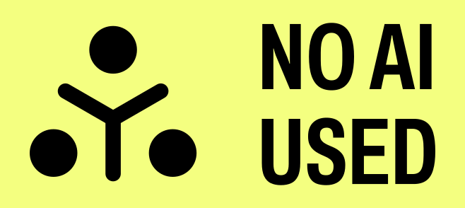

# Python For Defenders

Python for Defenders: Code, Detect, Defend.

This repository contains course materials for the "Python for Defenders" course at [The Taggart Institute](https://taggartinstitute.org).

## License/Copyright

Although this repository is open source and suggestions in the form of Pull Requests are welcome, this remains the intellectual property of The Taggart Institute, LLC, under the following license:

 This work is licensed under a <a rel="license" href="http://creativecommons.org/licenses/by-nc-nd/4.0/">Creative Commons Attribution-NonCommercial-NoDerivatives 4.0 International License</a>.

## AI-Free Disclaimer

No part of this book was generated by a large language model such as ChatGPT, Claude, or Gemini. The prose and code you see here was created by humans, mostly by me, Michael Taggart, with help from open source software authors and contributors.

## Changelog

- **2026-03-12:** Update dependencies
- **2022-09-21:** Added Usage; fixed test for 1-2. 
