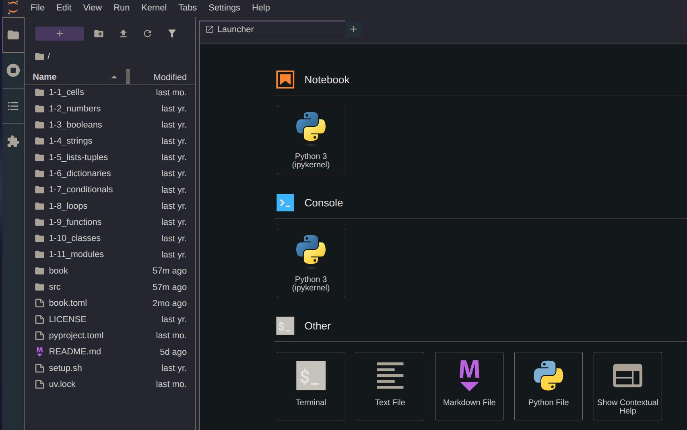

# 0-4: Environment Setup

Let's prepare our environment for Python programming. Python is cross-platform, and so are our setup instructions. You can perform this setup on Linux, macOS, or Windows.Even BSD will be fine! However, I *strongly* encourage a Unix-like operating system as the base. As mentioned in the [Intro](0-1_welcome.md#required-materials), I would use Windows Subsystem for Linux if you're on a Windows OS to easily get started in a Linux environment. Regardless of your OS choice, our first setup task is to install `uv`.

…after I explain why we need to.

## The State of Python in 2026

The Python language is a vibrant, thriving ecosystem. The fields of data science and machine learning adopting Python as the language of choice has even further cemented its ubiquity. But Python has a messy side as well. Managing Python dependencies and managing versions can get complicated quickly. The `pip` package manager, native to the Python ecosystem, has been disfavored by many Linux distributions which have opted to provide Python packages with their native repositories via `apt` or `dnf`. The Python Project format, `pyproject.toml`, has no official tool to manage it or its declared dependencies.

As a result, many tools have emerged to solve these issues. Previous iterations of this course have used [Poetry](https://python-poetry.org) for dependency management. Poetry is still a valuable tool, but it doesn't solve all the problems of managing Python. We want as simple a solution as possible for our tooling so we can focus on writing code. That's where `uv` comes in.

## `uv`

### Why `uv`?

The `uv` tool from Astral is a Python distribution, package, and project manager all in one. Not only will it handle project dependencies, but it will also install multiple versions of Python itself. It can also handle installing standalone Python binaries you might want to use on your system.

We will use `uv` for our Python tooling in this course. If you've done any work with Python in the past, this might take some getting used to, as some familiar commands will be preceded by `uv`.

### Installation

Head over to the [documentation site](https://docs.astral.sh/uv/) for `uv`. Keep these docs handy; they'll help you get familiar with the `uv`tool syntax.

On the [installation page](https://docs.astral.sh/uv/getting-started/installation/), follow whichever installation method you feel most comfortable with. I recommend the standalone installer, although I encourage the curious to read through the [installer script](https://releases.astral.sh/installers/uv/latest/uv-installer.sh).

Once the installer is finished, confirm the command is available on your shell by running `uv self version`. If it isn't, you may have to restart your shell session (close the terminal app/reopen it, among other methods).

### Install Python

Now that `uv`'s installed, we can use it to install multiple versions of Python. See what's available with `uv python list`.

The list you see will contain `<download available>` listings, and likely also some discovered Python versions on your system. At the top of the list, you'll see some with `rc` in the version. These are release candidates that have not yet reached general availability. I recommend installing the most recent major version that's generally available. As of this writing, Python 3.14 is the most recent major version. Therefore, I'd run:

```bash
uv python install 3.14
```

You now have that version of Python globally installed and available.

## This Repository

In whatever directory you prefer, clone this repository and enter it.

```bash
git clone https://codeberg.org/The-Taggart-Institute/python-for-defenders
cd python-for-defenders
```

### Initialize Virtual Environment

While you can—and often do—install Python packages globally on your system, often you want to avoid that for project-specific work. What if Project A uses version 4.2 of a package, while another requires 5.0? To isolate package dependencies—and even Python versions—we use **virtual environments** for per-project isolation. We can intialize a new virtual environment in our repository with:

```bash 
uv venv
```

You'll be told you can activate with a `source` command. Do that now. For Bash shells, that will look like:

```bash
source .venv/bin/activate
```

> For fish shell users (like myself), there's a `.venv/bin/activate.fish`. There's also `.ps1` for PowerShell users.

That'll change your shell a bit! Your shell has been modified to consider this `.venv` as your local Python environment. Prove it to yourself. If you're on Bash, you can try `which python` to confirm that the `python` command resolves to a file in this `.venv` directory. For PowerShell users, this would be `Get-Command.`

> I won't keep providing PowerShell alternatives. I already suggested WSL, but if you've chosen the path of pain, I cannot help you.

You don't always need the virtual environment activated. To deactivate it and return to a normal shell, simply run `deactivate`.

A handy feature of `uv` is that it will look for local `.venv` folders and use that as its context for certain commands. In fact, let's run one right now.

### Install Dependencies

Take a look at the `pyproject.toml` file in the root of the repository. You'll see some metadata about the project, but more importantly, you'll see a list of package dependencies. You'll see other Python projects list these in a file called `requirements.txt`, which is meant for the `pip` package installer. That's fine, but `pyproject.toml` is the [new standard](https://packaging.python.org/en/latest/guides/writing-pyproject-toml/). It does more than just list dependencies, but we'll explore those functions as they come up.

For now, we'll use `uv` and this file to install dependencies. Run the following command, either with the venv activated or not.

```bash
uv sync
```

This "syncs" the state of the project to match what `pyproject.toml` declares. You should see quite a lot of package installation occurring. But where did they go?

Inside of the `.venv` directory is a `lib` subdirectory that contains libraries for all installed Python versions in the environment. You can explore this structure to find what you just installed. You might also want to run `du -sh ./` to see just how much space this takes.

## Running Commands

Our environment is now set up for use, but I want to make sure you understand how to run commands in this environment. Essentially, you have two choices: activate the venv, or `uv run`. We've already covered how to activate the venv in a given shell, but `uv run` will execute commands as though the venv were activated, even if it isn't. Give this a try (with the venv deactivated):

```bash
uv run which python
```

You should see the path to the venv version of the Python binary, instead of a global installation like `/usr/bin/python`.

This also means you can run Jupyter directly without entering the venv.

## Launching Jupyter

This is it! Once Jupyter Lab is up and running, we're reading to get started. With the venv activated, run:

```bash
jupyter lab
```

With the venv deactivated, run:

```bash
uv run jupyter lab
```

Either way, a browser window should launch with Jupyter Lab running.



If a browser window doesn't open, copy the URL from the terminal (including the token!) to a browser.

To stop Jupyter, hit `Ctrl+C`.

That's it! Let's get started on Jupyter Basics.
