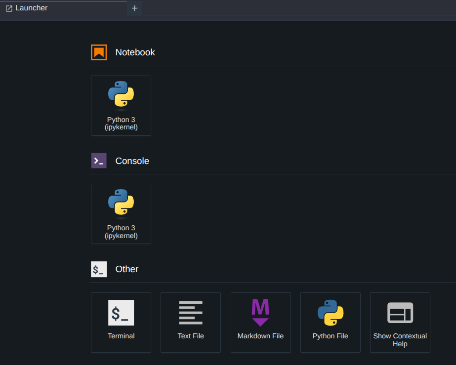
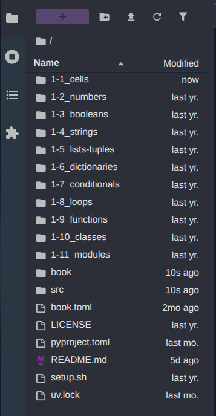
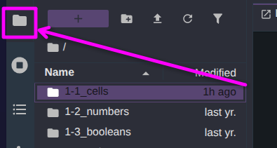
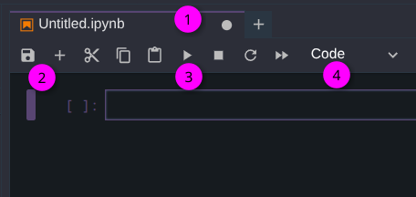
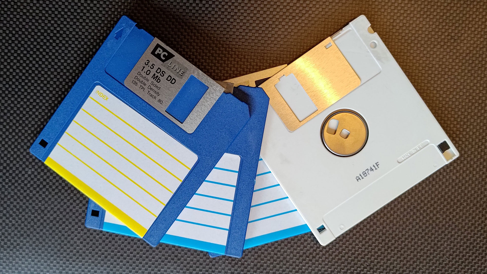
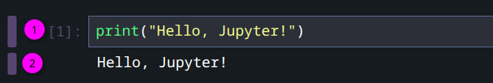
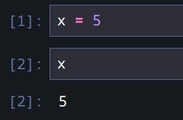

# 1-1: Cells

**Related Notebook:** `1-1_cells.ipynb`

<iframe style="width: 800px;height: 500px" src="https://www.youtube.com/embed/rjfL7YN0tyQ?si=6AFPvkmP-s-k-tOe" title="YouTube video player" frameborder="0" allow="accelerometer; autoplay; clipboard-write; encrypted-media; gyroscope; picture-in-picture; web-share" referrerpolicy="strict-origin-when-cross-origin" allowfullscreen></iframe>

Welcome to Jupyter! We're going to get familiar with the interface, then cover the basic unit of computing in Jupyter: cells.

## Interface Tour

### The Launcher

When you open Jupyter, you'll see a tabbed and paned interface with a Launcher front-and-center.



This launcher is the easiest way to kick off a new Jupyter Notebook, but it also has launcher for a built-in Terminal, raw text editor, and even a Python editor with syntax awareness. Mostly, we'll use the Notebook button, but the others can be handy. You can always reopen this launcher from **File → New Launhcer** in the menu bar. All of the options are also available in the **File → New** submenu. 

### Browser

On the left of the interface, you'll see a file browser.



This allows you to quickly navigate through the directory structure under which Jupyter was launched. Note that at the top of the browser, that directory is noted as `/`, or the root. Jupyter won't let you navigate outside that directory.

> [!NOTE]
> Jupyter *will* follow symbolic links, so don't do anything goofy like put a link to a sensitive directory inside wherever Jupyter runs.

Right-clicking on files and folders in the browser will bring up common file operations. You can also right-click in the empty space to create new files, folders, Python-specific files, and Notebooks.

If the file browser is taking up too much screen real estate, you can collapse it by clicking on the folder icon on the top left.



## Cells

Let's start using this thing. With the Launcher or any other method, create a new Notebook. It can be named `Untitled.ipynb` for now. This is just a demo Notebook.

Take a look at the tab and the buttons just below the tab title.



Some important points of interest here.

1. That dot indicates the file is unsaved. Jupyter doesn't save files automatically!
2. The save button. `Ctrl+S` also works. Children, it is a [floppy disk](https://en.wikipedia.org/wiki/Floppy_disk#3%C2%BD-inch).

3. The "Play" button executes the current cell. More on this shortly. The stop button stops execution of the current cell.
4. This dropdown determines what kind of cell you're writing. The three options are Code, Markdown, or Raw, but we'll only ever use Code or Markdown.

## Making Cells

Let's create a Markdown cell to start. Change "Code" to "Markdown" in the dropdown, and in the cell, enter some Markdown text like:

```markdown
# This is Markdown

Here's some markdown text.
```

Then, either press the play button or `Shift+Enter` to execute the cell and create a new one underneath it. You'll notice the cell type reverts immediately to Code. So let's write some code.

```python
print("Hello, Jupyter!")
```

Again use the Play button or `Shift+Enter` to execute the cell. A few things happen when you do.



1. Jupyter is telling you the order of execution of cells. This is the first cell executed in the notebook. Running it again will change this number. This is handy if you have later cells that depend on previous cells that need to be re-run due to updates.
2. The cell has output! Whenever we ask our Python to generate output, either with a `print()` statement, invoking an expression, or other output, it will appear beneath the cell. You can right-click on the output and choose "Clear Cell Output" to reset the cell. You can clear outputs of an entire Notebook, resetting it to initial state, with **Edit → Clear Outputs of All Cells**. You can also fully reset the notebook's memory with **Kernel → Restart Kernel and Clear Outputs of All Cells**.

But what *is* a kernel anyway?

## The Kernel

In Jupyter, a "kernel" is both a programming language interpretation/execution layer and the term for a running process for a given notebook. We're using `ipykernel` for Python, but there are [many others](https://github.com/jupyter/jupyter/wiki/Jupyter-kernels). You can even use Jupyter with PowerShell!

I need to stop mentioning PowerShell.

The kernel maintains state for the Notebook. We'll find out more about that when we get to variables, but if you want to completely start a notebook's execution from scratch, you want to restart the kernel.

## Cell Output

Let's fill in a second cell with a simple expression.

```python
5+5
```

And again, run the cell. You'll see output beneath the code. This is important. Jupyter will display the result of the last expression in a cell as the output. If you add `2*2` on another line in the same cell and re-run it, the output changes from `10` to `4`. If you wanted both results to display, you'd need to wrap both in a `print()` call, like so:

```python
print(5+5)
print(2*2)
```

## Variables

In Python, like all programming languages, we can store values for later use under named buckets called **variables**. Different values have different data types, as we'll soon see. But I want you to be familiar with the idea of variables right away, and that _cells share variable values_.

Create a new cell and run the following expression:

```python
x = 5
```

Then in a new cell, simply ask for `x`

```python
x
```



Two important discoveries here. First, we **assign a value to a variable** with the `=` operator. A *single* equals sign. It might seem weird that I'm specifying one, but it will matter later. Second, we've demonstrated that variable values persist across cells. However, execution order matters. I can't declare a variable in a cell that executes *after* one in which I reference it.

But if I decide I need a variable, I can make the cell and then reorder the cells in my notebook.

### Type Hints

In the associated notebook, you'll see **type hint** notation like:

```python
message: str = "Hello, World!"
```

The `: str` component is the type hint. As we just saw with `x = 5` above, they're not required. However, they are good practice in Python. Not only do type hints tell other programmers what data type you intend a variable to be, but many developer tools like **linters** (automated processes that review your code) will detect violations of type hints. Python itself won't, but the linter will.

## Moving/Deleting Cells

Cells are independent entities, even if they can produce objects in the kernel that other cells can reference. You can reorder cells by clicking and dragging to the left of the code/text. You can also delete cells with `DD` when a cell is selected, or right-clicking on the cell.

Make sure to go through the related Notebook and complete the Check for Understanding before moving on to the next lesson.
