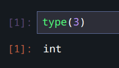
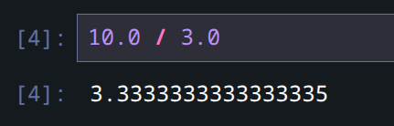

# 1-2: Numbers

<iframe style="width: 800px;height: 500px" src="https://www.youtube.com/embed/kmqfUvTkfBw?si=lE5IAlzGOjdhAorq" title="YouTube video player" frameborder="0" allow="accelerometer; autoplay; clipboard-write; encrypted-media; gyroscope; picture-in-picture; web-share" referrerpolicy="strict-origin-when-cross-origin" allowfullscreen></iframe>

**Related Notebook:** `1-2_numbers.ipynb`

This is a quick one, but contains some important core concepts.

## Data Types

All values in a programming language are of a certain **data type**. These types dictate how we interact with the information, and what properties and capabilities they possess in the language. We can use the `type()` function to determine the data type of any value or expression. 

## Types of Numbers

Let's try that with the number 3.



`type(3)` yields type `int`. It's an integer, also known as a whole number. That's distinct from the other kind of number in Python, a `float`. In a new cell, try:

```python
type(3.3)
```

You get `float`. These are "floating-point" numbers, also known as number with a decimal point in it, and some degree of precision. But be careful: `float`s do not have perfect precision. Check this out.



This is a division operation. 10 divided by 3 is, of course, an irrational number. You might recall that the actual value should be 3.333..., with no end of 3s. Well, floating point numbers need to lop it off somewhere, and doing so has unexpected results at the tail end of its precision.

We often combine `float`s with the `round()` function, which take a value or expression, and a precision value. So `round(10.0 / 3.0, 3)` yields `3.333`. 

## Basic Operations

Python has all the mathematical operations you might expect for numbers.

- Addition: `+`
- Subtraction: `-`
- Multiplication: `*`
- Division: `/`
- Exponentiation: `**`


There *is* a square root function, but it's in the `math` module, which we haven't touched yet. However, if you remember your algebra class, you can achieve square roots by raising to ½, or `0.5`.

```python
100 ** 0.5
# => 10
```

There's one less common operation you should know about: modulo.

### Modulo (`%`)

The modulo operation yields the remainder of integer division. For example, `10 % 7` yields `3`, because 10 divided by 7 in integer division (think long division) is 1, remainder 3.

That remainder is more handy than you might think! For example, it's common to check for evenness or oddness of a value using modulo. `n % 2` will *always* yield `0` for an even number and always `1` for odd.

## Order of Operations

Good ol' [PEMDAS](https://en.wikipedia.org/wiki/Order_of_operations#Mnemonics) is respected in Python math expressions. But parentheses matter—both to the code and to human readers, so please don't forget them!
