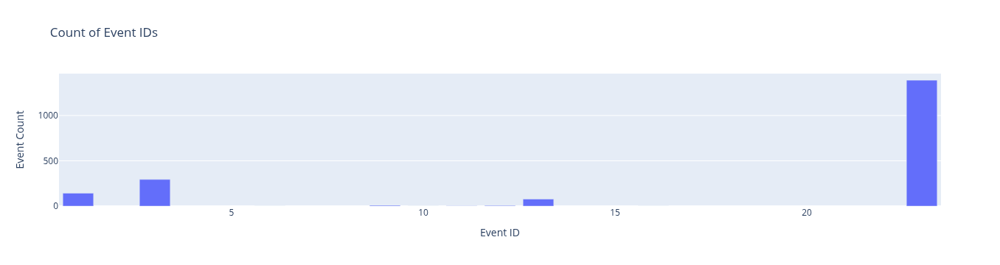
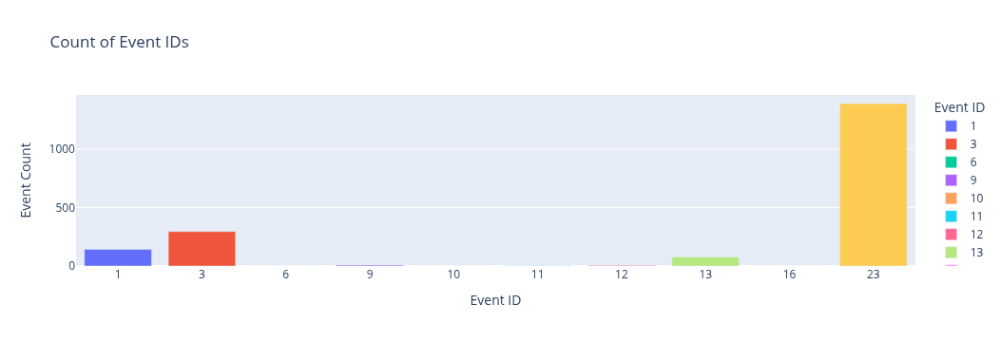
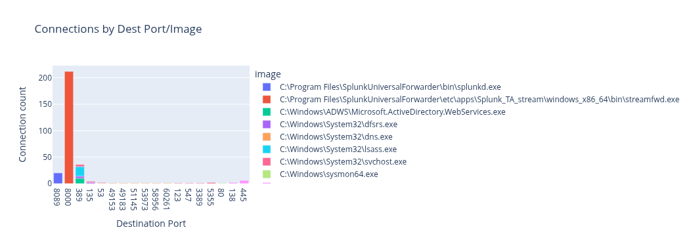
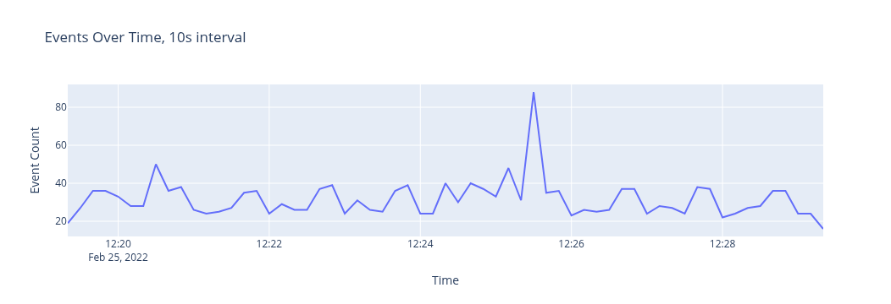
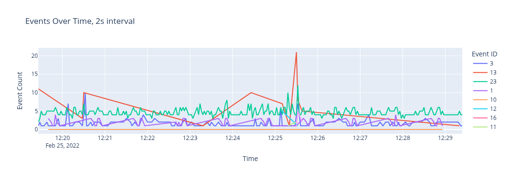
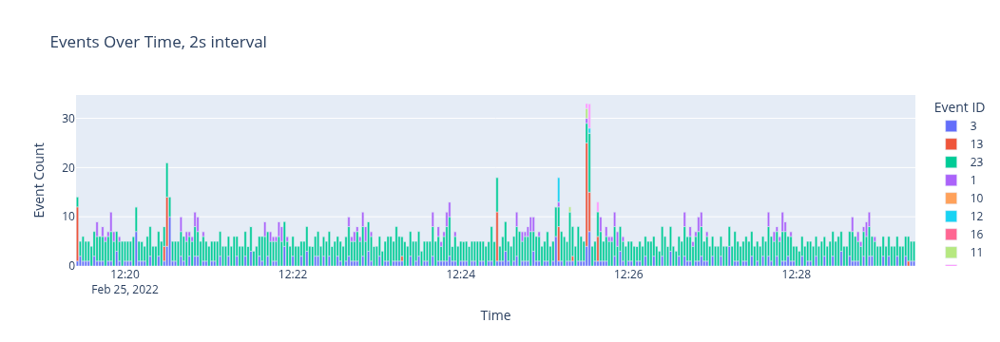

# 6-2: Advanced Visualization

Our last lesson introduced the concepts around visualization: x and y axes, plotting, and slicing `DataFrame`s specifically for use with graphing. You probably wished that the charts we made were better-looking, or bigger, or dynamic, or all of the above.

Me too. Even though Matplotlib is great for a lot of things, here's the truth: I never use it for my charts in real life. It's just too inflexible.

Instead, I use [Plotly](https://plotly.com/python/).

Plotly is my first stop. For most of the charts I need to make, Plotly is flexible and visually appealing. Altair does one thing much, much better though which makes it indispensible: time series.

We'll get to how those work in a moment. For now, let's import this library and see how it differs from Matplotlib.

Even importing Plotly is a bit different. We pull a submodules: `plotly.express`. Sometimes we also need `plotly.graph_objects`, but not for what we'll be doing here

```python
# Import our libraries
import sys
sys.path.append("../lib")
from sysmon import load_xml
import pandas as pd
import plotly.express as px
```

Now, let's get our next sample. It's more Sysmon data, but from a different incident.

```python
# Download the Sysmon data.
import os
if not os.path.exists("sysmon.log"):
    ! curl -L -o sysmon.log https://media.githubusercontent.com/media/splunk/attack_data/master/datasets/malware/hermetic_wiper/sysmon.log
```

And once more, let's load our `DataFrame`.

```python
# Create our DataFrame once more
evts = [vars(e) for e in load_xml("sysmon.log")]
df = pd.DataFrame(evts)
```

Okay, let's get comfortable with a basic bar chart: a count of Event IDs. In Plotly, we pass the `DataFrame`, the `x` and `y` fields, and a `title`. We can also pass a `label` argument for the axes. That's pretty much it. Let's do it!

Don't forget we need the values to be correct, so we'll do `groupby()` to get our counts.

```python
# Create our bar chart
events_by_id = df.groupby("event_id").count().reset_index()
px.bar(events_by_id, x="event_id", y="pid", title="Count of Event IDs", labels={"event_id":"Event ID", "pid":"Event Count"})
```


So it's not perfect, but look at what we have. In addition to a much larger viewspace, the chart is interactive! We can hover over the bars for more information, zoom in/out, and even download the chart as a `.png`. This is why I use Plotly.

But this is hardly as nice as we want the chart. For one thing, we'd want to fix the X axis. Plotly interpreted the Event IDs as numbers, and therefore interpreted it as a range. We can fix that by forcing the axis to be categorical, rather than numerical data. To do this, we will create a stringified Event ID column and use that for our X-axis _and_ our color!

```python
# Add stringified event_id
events_by_id["event_id_str"] = events_by_id.event_id.astype("str")
# Same chart, but with a categorical, stringified x-axis, and color!
px.bar(events_by_id, x="event_id_str", y="pid", title="Count of Event IDs", labels={"event_id_str":"Event ID", "pid":"Event Count"}, color="event_id_str")
```



Not too shabby, right? Resize your browser window.

Aww yiss, responsive charts!

Now let's see what else we can do. 

## Multi-dimensional analysis

Right now we're plotting x and y, which is handy of course. But what if we could add a 3rd dimension? The `color` gives us this capability. 

For example, what if we looked at network connections by destination IP. And then, what if we could split them by `image` to identify what processes were making the most noise?

Instead of stringifying the `dest_port`, we will modify the figure not unlike our modification of the axes in Matplotlib. We can use `update_xaxes` to set the axes type as `categorical`, making Plotly track the `dest_port` correctly.

Now, we need counts of connections by both `dest_port` and `pid`, but how do we do that? 

If we `groupby()` both and then reset the Index, we'll get both values in individual rows, along with the counts. This will provide us both values at once to graph. We can count `user_id` as our y-axis.

```python
# Slice our df to get network connections, then group by out 2 values
network_conns = df[df.event_id == 3].groupby(["image", "dest_port"]).count().reset_index()
fig = px.bar(network_conns, x="dest_port", y="user_id", color="image", labels={"dest_port": "Destination Port", "user_id": "Connection count"}, title="Connections by Dest Port/Image")
fig.update_xaxes(type="category")
fig.show()
```



This technique is a powerful view into event data. Being able to cut across 2 dimensions at once reveals outliers and correlations.

Time is a tricky thing. Python represents time data in `datetime` object. Right now, the `DataFrame`'s `time_generated` field is just a `str`. Luckily, it's of such a format that we can easily convert it to a `datetime` object with Pandas's built-in `to_datetime()` method. We'll add that as the `_time` field, just like a Splunk dataset.

```python
# Create a proper datetime field
df["_time"] = pd.to_datetime(df.time_created)

# Drop the soup field to avoid weird issues with Plotly
df.drop("soup", axis=1, inplace=True)
```

```python
# Examine our new column
df._time
```

Having the `_time` field by itself isn't all that helpful. We'd need to get counts of events grouped by time in some way. Unfortunately, Plotly can't do that for us. We need to use the `datetime` methods to group our data usefully. 

[`pd.Grouper()`](https://pandas.pydata.org/pandas-docs/stable/reference/api/pandas.Grouper.html) allows us to use the `datetime` as a grouping mechanism. The function takes a `key` for the `datetime`  field to use, and a `freq` argument that defines the grouping frequency. The `freq` argument takes a specially-formatted string that indicates the grouping interval. Let's give it a try in tabular form to see the results.

```python
# Group by time, every 10s
df.groupby(pd.Grouper(key="_time", freq="10s")).count().head()
```

So! Our Index (which we will need to reset for graphing) is a timestamp, but notice: each row is 10 seconds later. Our events have been grouped and counted in those time, uh, buckets. Time buckets. That's what I'm going with.

Plotly can easily use these time buckets to plot events. Let's do a raw events over time with this method.

```python
# Raw events over time
events_10s = df.groupby(pd.Grouper(key="_time", freq="10s")).count().reset_index()
px.line(events_10s, x="_time", y="pid", title="Events Over Time, 10s interval", labels={"_time":"Time", "pid": "Event Count"})
```




Change the `freq` value to see how the bucket size changes the story we're telling. At the `10s` size, it seems like something interesting was happening around `12:25:30`. A smaller bucket (finer resolution) gives us even more precision.

Now about those colors. What if we wanted to graph the Event IDs separately?

We can use the same trick with used with `dest_port` and `image`—a double `.groupby()`—to split these by Event ID.

```python
# Events by Event ID
events_2s = df.groupby([pd.Grouper(key="_time", freq="2s"), "event_id"]).count().reset_index()
px.line(
    events_2s, 
    x="_time", 
    y="pid", 
    title="Events Over Time, 2s interval", 
    labels={"_time":"Time", "pid": "Event Count", "event_id": "Event ID"}, 
    color="event_id"
)
```




This really tells an interesting story about what was happening in the `12:25:30` time space. Even though this is just raw volumetric analysis, we see spikes across almost all Event IDs. 

Oh, did you click on items in the legend yet? You can show/hide different series.

I like line charts for time series, but a stacked bar can also give us a nice sense of proportionality. Let's redo the same chart, but use a `bar` type instead. For whatever reason, to make the `color`s work, we'll need to stringify the `event_id`.

```python
# The same, but bar style
events_2s["event_id_str"] = events_2s.event_id.astype("str")
px.bar(
    events_2s, 
    x="_time", 
    y="pid", 
    title="Events Over Time, 2s interval", 
    labels={"_time":"Time", "pid": "Event Count", "event_id_str": "Event ID"}, 
    color="event_id_str"
)
```




I think it's cool how, especially when you zoom in on the `12:25:30` section, you can really see the proportionality of different events.

## Non-Standard Datetimes

Every so ofen you'll come across a log type that has weirdo timestamps that Pandas can't parse. Like, I dunno, SYSLOG?!

```python
# Totally reasonable Syslog format that Pandas can't handle
try:
    pd.to_datetime("Nov 13 09:03:52")
except:
    print("Pandas can't do that for some reason ¯\_(ツ)_/¯")
```

Luckily, [`pd.to_datetime()`](https://pandas.pydata.org/docs/reference/api/pandas.to_datetime.html) has a `format` optional argument that takes the formats supported by [`strftime`](https://docs.python.org/3/library/datetime.html#strftime-and-strptime-behavior). 

So we can in fact teach Pandas how to read Syslog datetimes.

```python
# One more time, with better information
pd.to_datetime("Nov 13 09:03:52", format="%b %d %H:%M:%S")
```

Closer, but we don't have year information so now it's…1900?

Pandas has a cool built-in `offset` library that allows us to fix things like this. The `DateOffset` object can be added to the `datetimes` to fix our years.

```python
# Now we're in the present!
pd.to_datetime("Nov 13 09:03:52", format="%b %d %H:%M:%S") + pd.offsets.DateOffset(years=122)
```
