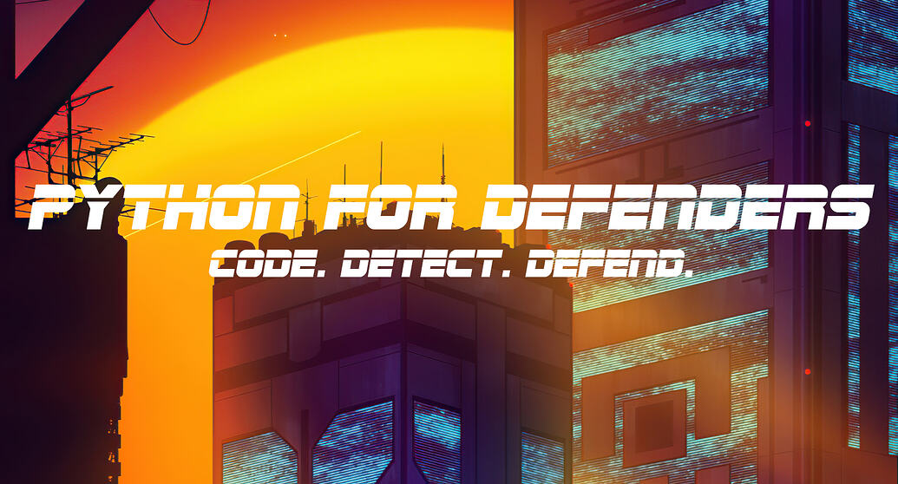

# Python For Defenders



Python for Defenders: Code, Detect, Defend.

## License/Copyright

Although this repository is open source and suggestions in the form of Pull Requests are welcome, this remains the intellectual property of The Taggart Institute, LLC, under the following license:

<a rel="license" href="http://creativecommons.org/licenses/by-nc-nd/4.0/"></a><br />This work is licensed under a <a rel="license" href="http://creativecommons.org/licenses/by-nc-nd/4.0/">Creative Commons Attribution-NonCommercial-NoDerivatives 4.0 International License</a>.

## AI-Free Disclaimer


No part of this book was generated by a large language model such as ChatGPT, Claude, or Gemini. The prose and code you see here was created by humans, mostly by me, Michael Taggart, with help from open source software authors and contributors.

## How to Use this Repo

This repository is intended for use in conjunction with the course [Python For Defenders](https://taggartinstitute.org/p/python-for-defenders).

To use the repo,

```shell
git clone https://github.com/The-Taggart-Institute/python-for-defenders
cd python-for-defenders
```

## Changelog

- **2026-10-07**: Complete rewrite and unification of parts 1 and 2
- **2026-03-12:**: Update dependencies
- **2022-09-21:**: Added Usage; fixed test for 1-2. 
